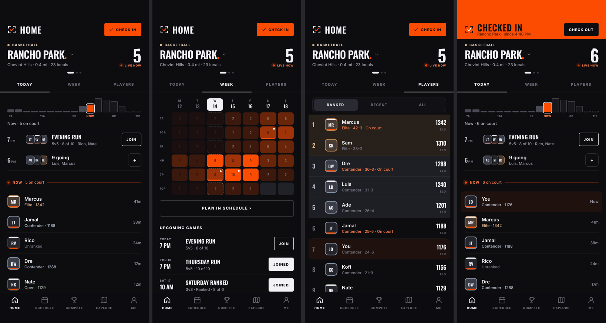
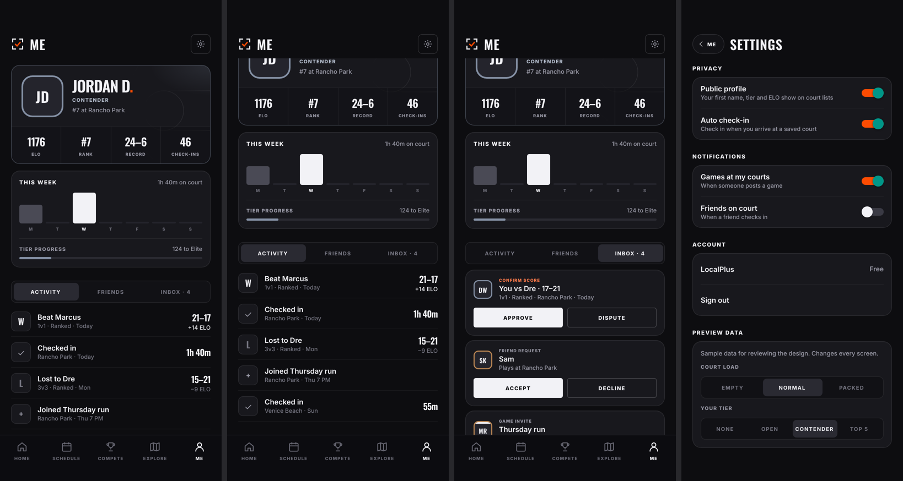
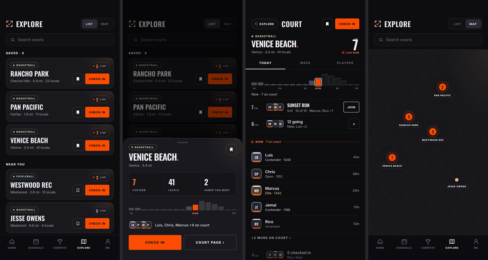

# Chunk 2: Design system

Status: In review

## Why
Screens were styled one by one, so they drifted: the Me header scrolled away
while every other header stayed put, rows were four different heights,
buttons four sizes, card corners two radii. Nothing stopped it.

## What changed
- `docs/DESIGN.md`: the contract. Page frame, type scale and when to use each
  style, spacing, sizes, components, motion, and how to add a component.
- `Page` draws the only header, fixed, on every screen. `PageScroll`, `Pager`
  and `Tabs` handle the body.
- Shared components: `Card`, `Group`, `Row`, `PlayerRow`, `GameRow`,
  `Section`, `StatStrip`, `NumberTicker`, `Menu`, `SearchField`, `HeatGrid`,
  `WeekBars`, `CourtMap`, `IconSwap`, `ProgressBar`, `Glyph`, `Rule`, `Dot`.
- Text by name (`t="rowTitle"`), sizes from `size` tokens.
- Motion on the moments in DESIGN.md: commit presses, gliding tab and segment
  highlights, icon swaps, rolling live counts, the header easing to orange,
  sheets. Routine taps dim.
- Every screen (Home, Explore, drawer, court page, Me, Settings, placeholders)
  rebuilt on these. Screen bodies moved to `src/screens/`.
- `npm run check` now includes `check:design`; `.github/workflows/ci.yml` runs
  it and an iOS bundle build on every PR.
- `AGENTS.md`: how work happens (chunks, sign-off, sub-agent models) and how
  UI is built.

## Not in this chunk
Explore card redesign (next), Schedule, Compete, game screens, Expo Go or
device builds, real data.

## Checks run
- `npm run check`: typecheck, token check and design check pass.
- The design check fails on a test screen with its own scrolling header
  (4 errors), then passes once it's removed.
- `expo export --platform ios` builds the iOS bundle.
- Every screen rendered in Chromium at 402×874 with no console errors.
- Me header measured at 62pt before and after scrolling 700pt.
- Not run: on a phone. The V5 mock couldn't be rendered for a side-by-side
  here (it loads React from unpkg, which this environment blocks); values were
  taken from its source.

## Screens

## Owner feedback
_(to fill in after review)_
